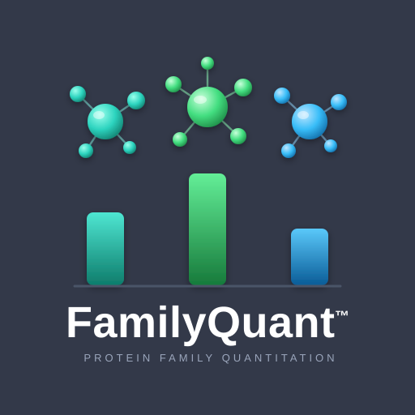
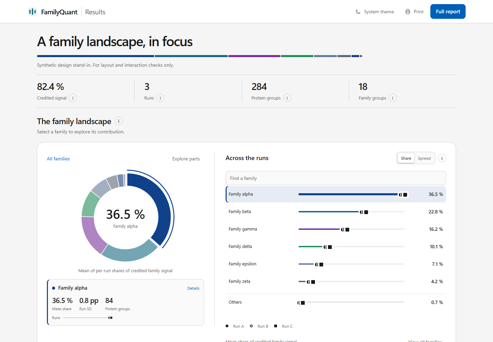
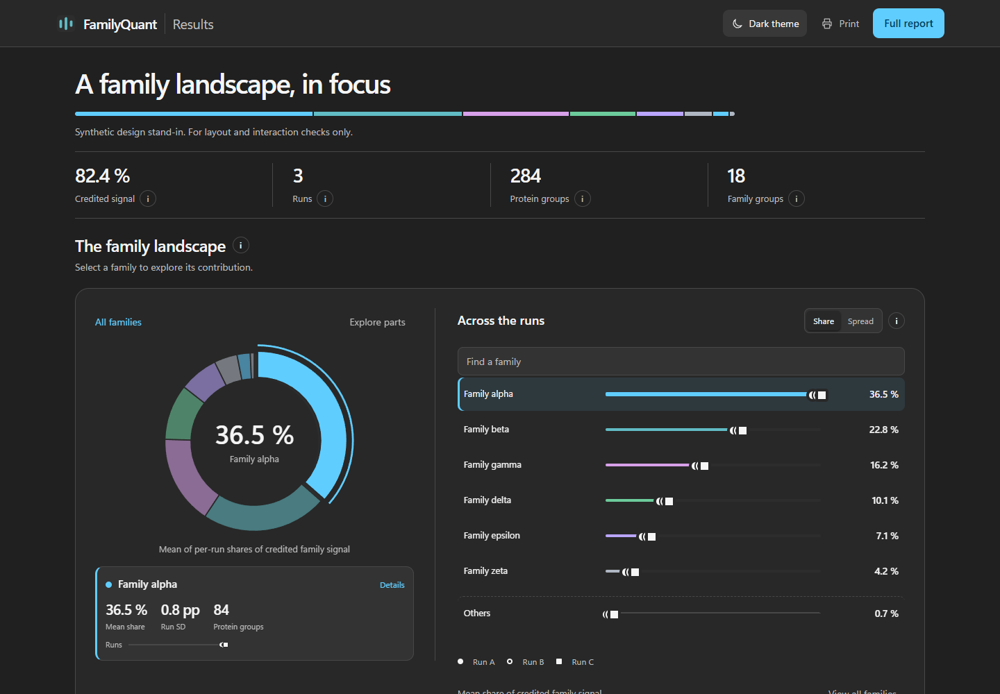
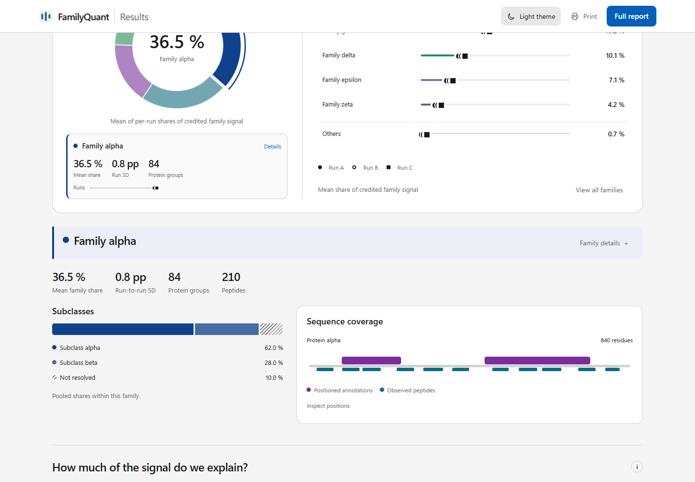
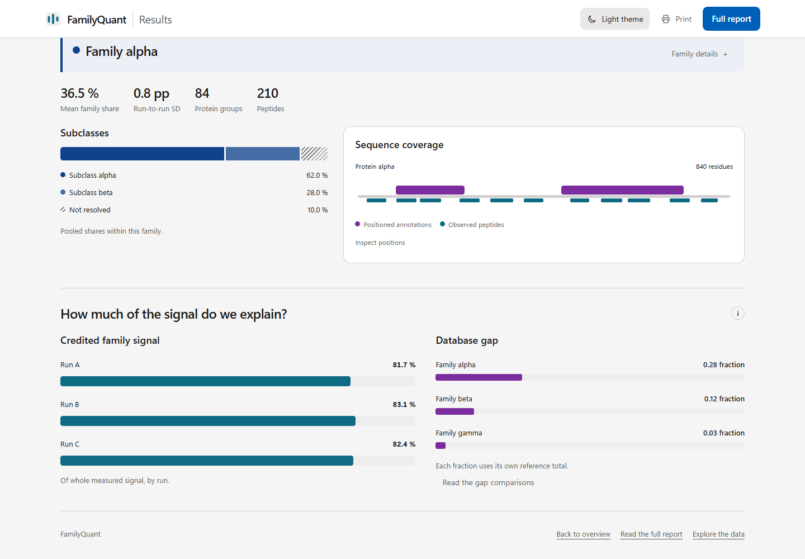
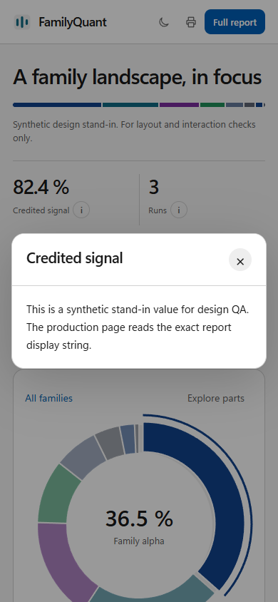

<h1 align="center">FamilyQuant 2.1.2</h1>

Protein-family composition from your own evidence.

FamilyQuant is a Windows desktop application for exploring protein-family composition from database identifications and de novo peptide evidence. It lets you curate families with your own panel and quantify their contributions across runs. It writes a report from the project's results, with a Word document, a workbook and an interactive page.

[Download the latest release](https://github.com/pcarvalho75/FamilyQuant2-releases/releases/latest) · [Step-by-step guide](#step-by-step) · [Troubleshooting](#troubleshooting)

> **Version note:** This guide describes FamilyQuant 2.1.2. Until 2.1.2 is published, the latest-release link may offer an earlier version.

## Explore the report

The new `report.html` opens beside the Word report and supplement workbook. It is a self-contained page: open it in a browser, explore it offline, switch between light and dark, use it on a phone, or print it.

The ring shows family composition. Select a segment or a family in **Across the runs** to inspect it; each run is a point, so variation is visible beside the mean. Short labels keep the view readable, and pop-ups show the exact values and explanations. Displayed result numbers are traced to the selected report, supplement or stored project values; the page does not rerun the analysis.

A selected family's detail shows its available parts and sequence coverage. The **Credited family signal** and **Database gap** views answer different questions and retain their own labelled bases.

On a narrow screen, select an information button to open its details. The example below shows a pop-up on a phone-sized view.

All screenshots on this page use synthetic data.

## What's new

**FamilyQuant 2.1.2** adds the interactive HTML report described above. It uses the selected report's prepared data and accompanies the existing Word report and workbook.

Earlier 2.1.x improvements include:

- **Faster Compute:** a faster search engine reduces work on the same inputs; the time depends on the project and computer.
- **Panel-family totals:** when your panel combines families, the headline presents their combined panel-family total while the supplement retains the original detail.
- **Score tier:** de novo evidence is credited to proteins tied at its best score by default. Opening an existing project preserves its stored results; the rule applies when you run Compute again.
- **Clearer reports and progress:** program-written findings, saved report details, explanations for unavailable values, counted progress and reusable search results.

## Install or update

1. Open the [latest release](https://github.com/pcarvalho75/FamilyQuant2-releases/releases/latest) and download its FamilyQuant zip.
2. Extract **the entire zip** into a folder where you can write files.
3. Run `FamilyQuant2.exe` from the extracted folder. Nothing is installed, and the .NET runtime is included.

Use 64-bit Windows 10 or 11. FamilyQuant 2 can sit beside FamilyQuant 1.5. To check for a newer release later, choose **Help > Check for updates**; the app opens the release page on request and does not install an update for you.

## Step-by-step

### 1. Open or create families

Choose **File > Open** to open an existing FamilyQuant project (`.fqproj`) or Family Cluster File (`.fcf`). To start from a protein database instead, choose **File > New from database**, select a FASTA or target-decoy `.T-R` file, set the identity and choose **Build families**. Open the resulting `.fcf` with **File > Open**.

Use **File > Save** to keep the project, its curation and computed results together. Use **Save as** when you want a separate copy.

### 2. Import your family panel

Choose **File > Import family panel** and select your spreadsheet. Choose the sheet and header row, preview the columns, and map your family keys, names, decisions and any optional Pfam information. Map each decision to the action you intend, review the preview and choose **Apply panel**. Panel literature, notes and sources remain your supplied text; they are not measured results.

### 3. Review family assignments

Open **View > Families**. If you need reviewed evidence, use **Fetch evidence**; then choose **Group by evidence**, review or edit the scope and choose **Update proposal**. Review ambiguous **Panel links**, confirm your choices with **Use link choices**, inspect the updated protein selections and choose **Apply grouping**. You can add a note to a link choice, and the grouping can be undone in the session.

### 4. Add inputs and compute

Choose **Analysis > Compute full XIC**. In Quantify, set **RAW folder** to the matching `.raw` acquisitions and **Identifications (.sepr2)** to the package from the same runs. **De novo folder (optional)** can contain PEAKS `*.denovoOnly.csv` or `*.denovo.csv` files and DeepNovo `*.deepnovo.csv` files; each selected source has its own score filter. **Search settings (optional)** can point to a `.params` file; if left empty, one unambiguous adjacent file may be selected automatically.

Review the available settings and choose **Compute full XIC**. Progress shows the current step and elapsed time; **Operation log** shows recorded steps and **Cancel** requests cancellation. Save the project after a successful computation.

### 5. Read the results

Choose **Analysis > Results** to explore the stored quantitation. Return to **View > Families** to inspect family assignments and the quantitation controls. Read each chart's labels and denominator: a family with **no peptide observed** in a completed study is not proof that the family is absent. Unavailable values are shown as unavailable rather than treated as zero.

### 6. Describe the report

Choose **File > Report details**. Enter the title, authors, sample description, workflow, database kind and any written interpretation you want to include. Choose **Save details**, then **File > Save** to keep the changes in the project. The program's own findings are written from stored studies; your panel text and written interpretation remain separately identified.

### 7. Export the three report files

Choose **File > Export report** after Results are ready. Select sections and figures, adjust **Report threshold (%)** if needed, and choose where to save the Word report. FamilyQuant writes three files beside one another with the same base name:

- `report.docx` - the Word report.
- `report_supplement.xlsx` - detailed tables and source values.
- `report.html` - the interactive, offline report.

The chosen base name replaces `report` in all three filenames. Keep the files together so the links between them work. Save the project if you want to retain the report choices and threshold.

### 8. Explore the HTML report

Open `report.html` in a browser. Start with the composition ring and the ranked per-run view, select a family for its details, then inspect available sequence coverage, credited signal and the Database gap. Select information buttons or values for explanations and exact values. Use the theme control for light or dark, and **Print** for a print-friendly view.

### 9. Optionally draft an interpretation with AI

The program's own report narrative is generated without an AI service. If you choose an AI draft, bring your own Anthropic API key and manage it under **Help > AI assistant key...**. The key is protected for your Windows user and is not saved in the project or report. If no key is saved and `FamilyQuant AI key.txt` is beside the opened project, the first eligible attempt offers to import it; keep that file private.

Choose **File > Draft interpretation with AI...**. Review the exact project information and model shown, and confirm before sending the information to Anthropic. Review the returned
draft and its list of recognized numbers not found in the input tables; a value match does not prove the meaning is correct. Accepting adds a labelled AI draft to the written interpretation; cancel or discard leaves the project unchanged. Use **File > Save** if you want to retain an accepted draft. Testing a key sends a short request without project data and may incur usage charges.

## Troubleshooting

- **Export report is unavailable or says Results are missing.** Open a computed project and wait for its family attribution to finish. If the project has no stored Results, run **Analysis > Compute full XIC** and save it first.
- **An input cannot be found.** Check that the RAW folder exists and contains the acquisitions, and that the `.sepr2` package matches those runs. The optional de novo folder is searched recursively for the selected source types.
- **A family shows no peptide observed.** This means no peptide reached that family in the completed study; it is not evidence that the family is absent. Check the panel, assignments, input coverage and the status shown for unavailable studies.
- **A value or panel link needs explanation.** Open **Help > How to read these numbers** for the current screen, or **Help > What do I do first?** for the full workflow. Review the panel links and the audit before applying changes.
- **The AI command asks for a key or cannot connect.** Add or import your own key under **Help > AI assistant key...** and use **Test key**. Check connectivity or the account's billing and rate limits if the app reports them. The rest of FamilyQuant and the program-written report work without a key.

For help in the application, use **Help > What do I do first?** or **Help > How to read these numbers**. Release downloads and update notes are on the [releases page](https://github.com/pcarvalho75/FamilyQuant2-releases/releases/latest).
