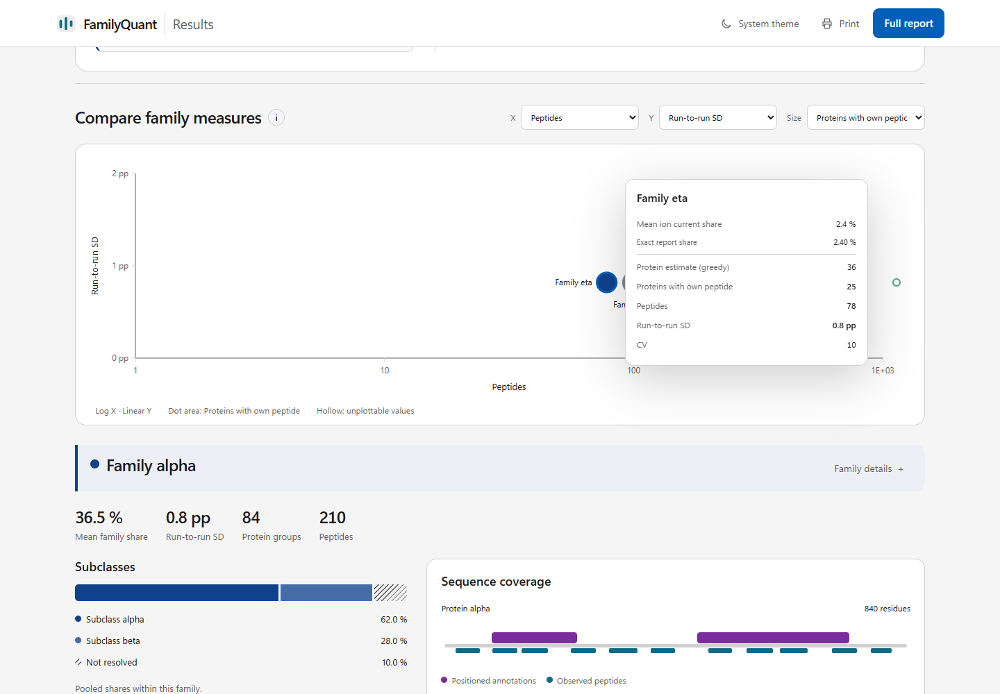
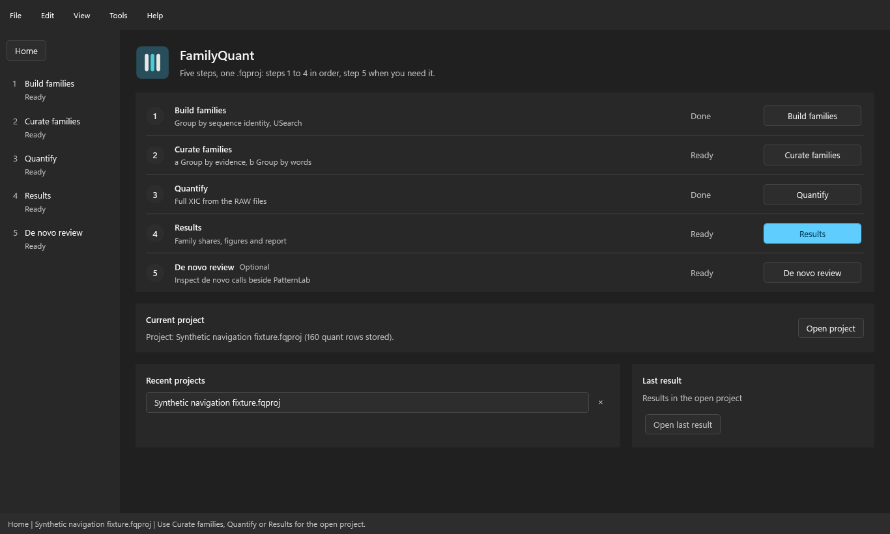
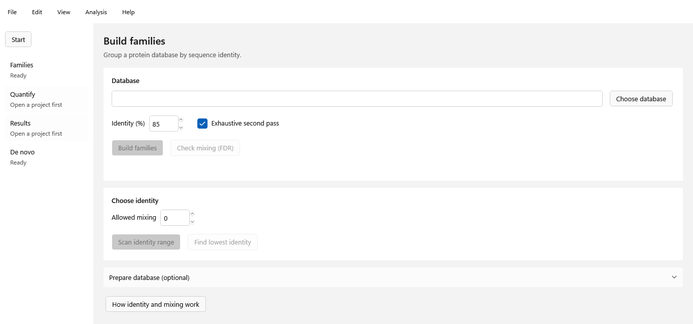
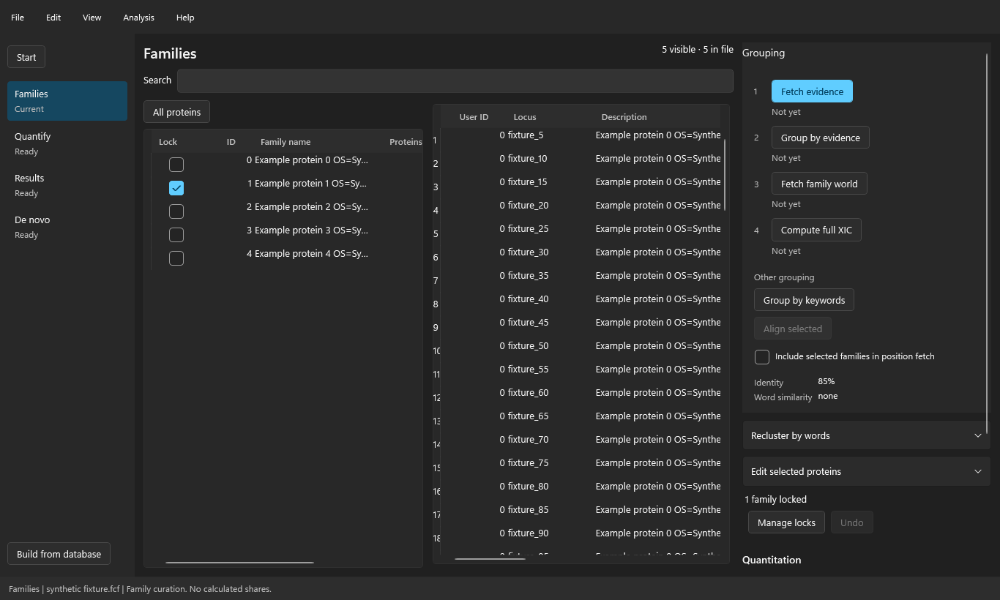
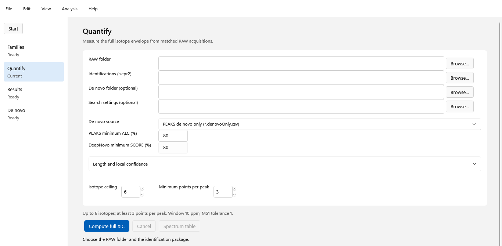
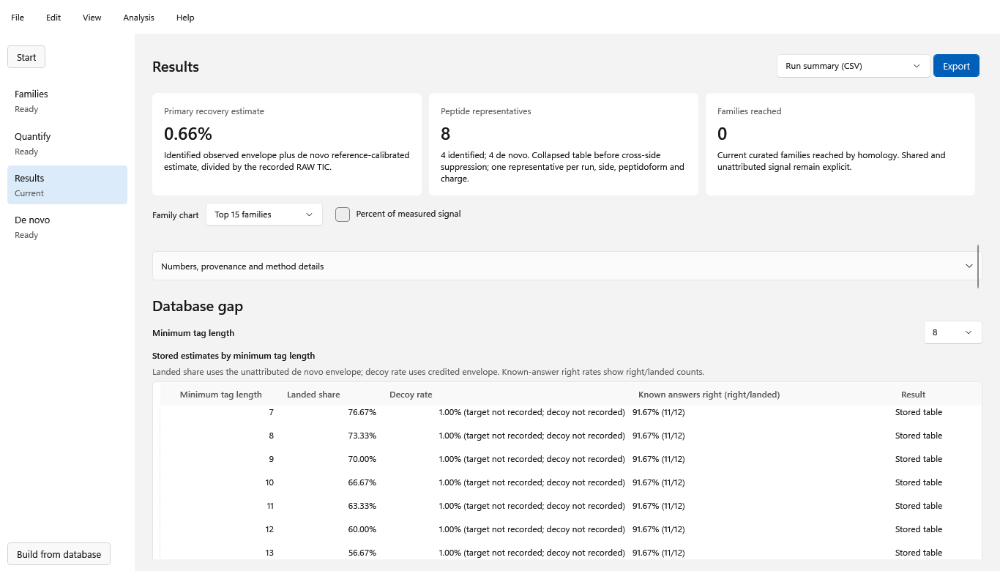
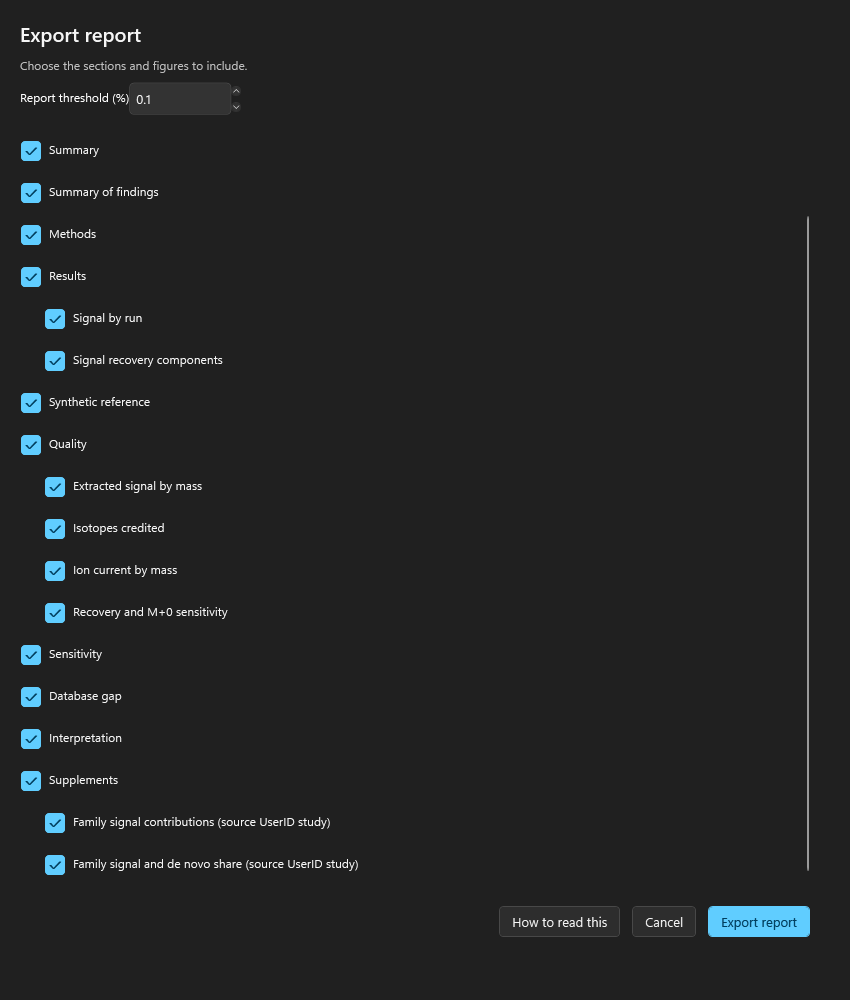
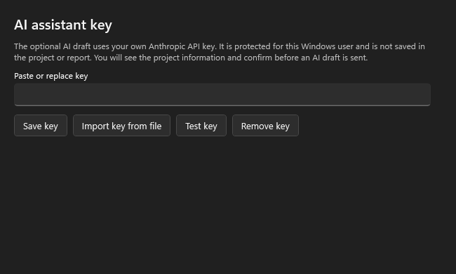

  <picture>
    <source media="(prefers-color-scheme: dark)" srcset="docs/images/familyquant-lockup-dark.png">
    
  </picture>

<h1 align="center">FamilyQuant 2.1.18</h1>

Protein-family composition from your own evidence.

FamilyQuant is a Windows desktop application for exploring protein-family composition from database identifications and de novo peptide evidence. It lets you curate families with your own panel and quantify their contributions across runs. It writes a report from the project's results, with a Word document, a workbook and an interactive page.

[Download FamilyQuant 2.1.18](https://github.com/pcarvalho75/FamilyQuant2-releases/releases/latest) · [Step-by-step guide](#step-by-step) · [Troubleshooting](#troubleshooting)

## What's new in 2.1.18

- **A family of your list keeps its members.** A row that names a UniProt family now also takes proteins that have no family annotation of their own, when the row lists every one of their Pfam domains and is their best row; a protein whose own UniProt family is a different one stays out, and the scope words work as before.
- **The report exports after you curate.** Moving proteins after Apply grouping (Edit selected proteins, Group by keywords, Recluster by words) no longer stops the report; the moved proteins show "Moved by you" or "Regrouped by words" in the protein audit, and Undo restores both.
- **Your sheet is taken as written.** Pfam codes in your family list are accepted before or after Fetch evidence, with **Un-confirm** in the import summary and in Family checklist; the Columns page shows only your sheet's columns and says why Next is unavailable.
- **The grouping steps in working order.** Group by words comes before Quantify; Fetch UniProt families is optional, since Fetch evidence already brings each protein's own UniProt family.
- **Family names in your language** (File > Export > Family names) and a **Pie** view of the family chart in the HTML report and on the Results screen.

### Earlier highlights

**2.1.17** introduced:

- **Review grouping fits a laptop screen.** "Where proteins go" opens to its three counts and their explanations and closes without leaving a gap; the status lines under the scope stay readable; the Family checklist spans the window with its reasons below, and the scope preview stays beside them. Projects, groupings and numbers are unchanged.

**2.1.16** introduced:

- **Quantify no longer stops when a run has no de novo calls.** The warning about such runs had stopped the computation with "The calling thread cannot access this object"; progress and warnings now always reach the window on its own thread.
- **Import family list is simpler.** **Use template** writes an empty sheet with a **Subclasses** sheet; a sheet with the program's columns goes through three pages; Pfam codes you give are taken as given; **Accept** closes the window and **File > Save** keeps the list at once.
- **A UniProt family column** keeps families that share a Pfam domain apart and carries your Panel links choices into new projects.
- **Fewer Panel links questions.** The row whose own Pfam list a protein covers most completely wins; only real ties are asked, and your choices always win.
- **Where every protein goes.** Review grouping counts proteins in your list, in-scope proteins outside it and proteins outside the scope; the Family checklist gives every row its state.
- **Subclasses in the report.** Subclasses defined in your list reach the HTML report, also for families below the report threshold, and a re-imported list updates families that were already grouped.
- **Clearer names.** **Fetch family world** is now **Fetch UniProt families**; every tab under **Show all options** says what it is for.

**2.1.15** introduced:

- **Every chart in the HTML report is drawn in the page.** Families, Signal recovery, Mass and isotopes, Database gap, Quality and Sensitivity draw their charts from the program's own numbers, instead of pictures. Point, tap or use the keyboard to read an exact value and what it is a percentage of; every chart names its base and works in light and dark, on a phone and in print.
- **Every protein's coverage.** The Coverage tab lists every family, including those below the report threshold and Others, and every protein with placed peptides.
- **The family ring follows Normalize to**, on a true 0 to 100% scale, with the part outside the shown families labelled.
- **Recovery explained again**, with a guide to what each of the four readings divides by and what the gaps between them can and cannot mean.
- **Recovery by mass range** replaces the "percent of ion current by mass" chart, in the program and in the HTML report. Projects quantified by an earlier version ask you to run **Quantify** again for this chart.
- **Plainer words.** Shorter family names (the full header shows on hover), a "What the numbers mean" panel, and each chart names its base once.

**2.1.14** introduced:

- **Each peptide counts once.** The family contribution chart credits a peptide to at most one family; shared peptides have their own bar beside unattributed signal, and the bars add up to 100%. The "count in every family" choice is gone.
- **De novo peptides use their measured envelope**, like identified peptides; the per-interval multiplier is gone. Results computed by an earlier version ask you to run **Quantify** again.
- **Everything in the HTML report.** `report.html` opens in tabs with every Results figure and a plain legend under each. **Normalize to** at the top redraws the family ranking and the family contribution chart as a percentage of PSM only, PSM and de novo, Detector envelopes or TIC.
- **A simpler program.** **Review grouping** opens in a Simple view, with **Show all options** for the rest. All exports are in one window, **File > Export**; the PNG figure export is gone, since the figures live in the HTML report.
- **Smaller fixes.** The recovery chart shows the real isotope range, Quantify warns when a run has no de novo calls, new projects start at isotope ceiling 6, and **Import family list** appears as an optional first step.

**2.1.13** introduced:

- **Read database and scope works while UniProt's bulk downloads are down.** It now uses the keyword categories that **Fetch evidence** already saved in the project, and reads UniProt's keyword list only for keywords without one, page by page. Species lineages are read page by page too.
- **The Scope box is always visible.** In **Review grouping > Evidence**, the Scope box and **Update proposal** sit directly under **Database and scope** and no longer scroll out of sight.

**2.1.12** introduced:

- **AI Help.** **Help > Ask AI Help** (Ctrl+H, from any FamilyQuant window) answers questions about FamilyQuant. It sends your question, what the program shows (version, screen, project, last error and the last lines of the log) and, only when you tick it, a picture of the window to Claude with your own Anthropic key, the same key as the AI draft. For technical questions it reads the FamilyQuant source code on GitHub and names the files and lines it used. **What AI Help sends** shows the text before you ask.
- **GitHub's limits.** GitHub allows 10 code searches a minute and 5,000 file reads an hour for all FamilyQuant users together. When a limit is reached, AI Help says so and when reading resumes.
- **Report this as a bug.** From AI Help, **Report this as a bug...** opens an editable report, then a new issue on the FamilyQuant releases page on GitHub with the full report on the clipboard and the picture saved for you to drag in. You submit it from your own GitHub account; issues there are public.
- **AI assistant key.** The key window says the same key is used by AI Help.

**2.1.11** introduced:

- **Import a whole workbook.** **File > Import family list** opens **Review your workbook** with the family list, workbook map, legend meanings, decisions, Pfam matches, subclass proposals and kept notes together. Change any section, then press **Accept and import** to keep the reviewed choices in one undoable step. Nothing changes in the project before that press.
- **Keep your source and your choices.** Review recognized required or absent Pfam rules, inspect the original cells, and edit or leave out proposals. Overlapping subclass definitions are named before import for review. Unmatched expected subclass names and other text the program cannot interpret stay as notes, which survive Save and reopen. Confirming the current family sheet keeps the draft; selecting another asks before clearing it.
- **Clearer import screens and Help.** Plain workbook messages point to the named review section, required choices are distinct from optional findings, and cell tooltips explain their column and value, including blank cells. Review tables and controls fit smaller windows, and the Decision-column question and source legend have clearer explanations. Try the example, save a template, or press **F1** for the illustrated workbook guide.
- **Family checklist and explicit curation.** Inspect matching proteins and reasons for leaving others out. **Add to scope** previews a keyword's effect; **Add to family** records choices as **Added by hand**, and families added by hand are displayed by name. Evidence matches show their coverage, and a broad match asks an extra counted question. Matching labels alone does not move proteins.
- **Fetch a reference panel for your scope.** The reference panel can be fetched for the chosen scope, with **Fetch missing panel** after widening it. **Full panel** remains available. Older projects keep their stored full panel until you explicitly fetch again.
- **Large projects and smaller saves.** Streamed reads and writes avoid one large text copy; compact files store repeated records once. Import and report checks show lower peak memory while preserving the checked content.
- **Readable tables and helpful controls.** Table text stays readable when controls are re-enabled or the theme changes, including in dark mode. Tooltips explain actions, column headers and unavailable controls.
- **Know what to do next.** Older projects explain when grouping, locks, Quantify or Sensitivity need attention. After applying panel grouping, a reminder says to run **Quantify** again before **Export report**.

**File compatibility.** FamilyQuant 2.1.11 opens older projects and `.fcf` files. Saving upgrades projects to version 3 with curation format 2; `.fcf` saves also use format 2. New saves require 2.1.11. Version 2.1.10 refuses a version-3 project with "Update FamilyQuant to open it". The FamilyQuant 1.5 export has been removed.

**Older calculated results.** On the checked project originally saved by 2.1.0, recomputing kept identified rows unchanged. De novo rows can differ because **PatternLab wins conflicting precursors**, on by default since 2.1.8, removes calls that conflict with a database identification for the same scan and precursor. Newly run Quantify credits a de novo peptide to targets tied at its best match score; earlier quantitation could credit every target above the identity threshold. On one checked project, the resulting family-share changes were at most about 0.1 percentage points.

**2.1.10** introduced:

- **Group by evidence stays open.** The progress card layout has been fixed. Errors in the review window are shown and logged.
- **Error reports.** If an unexpected error forces FamilyQuant to close, it first saves a report in its logs folder and says where. Errors in background work are recorded in the same folder without closing the program. Use **Help > Open error logs folder** to open the folder.

**2.1.9** introduced

- **Read database and scope** uses batched UniProt taxonomy queries for the species in the database, respects the server's Retry-After wait on HTTP 429, and keeps completed lineages for a retry.
- **Evidence is added to the open project.** Messages now say what was added and remind you to use **File > Save** to keep it.
- **Reconcile Help matches the code.** De novo Help describes the direct precursor m/z match within 20 ppm.
- **Neutral presentation captions.** Exported presentation figures use neutral caption text.
- **Shorter cache names.** Evidence resume cache files use shorter names to reduce path length.

**2.1.8** introduced:

- **Home shows five numbered steps.** In order: **1 Build families** (group by sequence identity, USearch), **2 Curate families** (part a **Group by evidence**, part b **Group by words**), **3 Quantify** and **4 Results**, then the optional **5 De novo review**. Each step shows its state and one button, and the sidebar numbers the same steps (Alt+1 to Alt+5; Alt+0 for Home). **Open project** and **Recent projects** stay below.
- **One name per thing.** Each screen keeps the same name in the sidebar, menus, Help and messages: **File > Build families** (formerly New from database), **Curate families** (formerly Families), **Quantify** (formerly Compute full XIC), **Results** and **De novo review** (formerly De novo evidence). The Analysis menu is now **Tools** and keeps the extra tools (**Spectrum comparison**, **Clustering diagnostic**, **Reannotate SEPro**); Quantify, Results and De novo review are also in **View**. With no project open, **Curate families** asks you to open one or to build families first.
- **Curate families screen layout.** Both grids have a title and their headers line up, **All proteins** sits above the protein grid, family numbers are centred, and the **USearch ID** column is shown by default.
- **Same-scan rule.** When PatternLab and a de novo call give different sequences for the same scan and precursor, the PatternLab identification wins and the de novo call receives no credit. **PatternLab wins conflicting precursors** is on by default in Quantify, and the report methods state the rule in use. Stored results change only when you run Quantify again.
- **De novo in FamilyQuant.** A new Help page explains how Quantify uses de novo calls and why De novo review is optional.

Earlier, **2.1.7** kept Fetch evidence's work: protein evidence is kept when the reference panel cannot finish, Fetch evidence waits and retries when UniProt is busy, resumes from the last finished batch for the same query and release, and names refused families; **Retry panel** finishes an incomplete panel. After a successful **Install update**, FamilyQuant reopens and shows its updated version once, and Setup compares versions before installing. **File > Close project** returns to Home after the usual Save, Discard or Cancel choice.

Earlier, **2.1.6** cleaned up **Recent projects**: files that are unavailable are hidden and appear again when reachable. To remove an entry, right-click it and choose **Remove from recent projects**, use its small **x**, or select it and press **Delete**. Removing an entry leaves the project file untouched.

Earlier, **2.1.5** introduced the guided **Grouping** steps, now part a of **Curate families**: **Fetch evidence**, **Group by evidence**, **Fetch family world** and **Quantify**. They highlight the next step and show each step's status. **Group by evidence** offers to download evidence first when the project has none, **Review grouping** explains why a scope cannot be suggested, and the **Read grouping task** screen counts the taxa it asks UniProt about.

Earlier, **2.1.4** added database entries to the family dot plot's X, Y and Size choices. When the required measures are available, it opens with database entries against mean ion current share. To see this in an existing project, use **File > Export report** to create a fresh HTML report. Quantify does not need to run again, and existing calculated numbers do not change.

Earlier, **2.1.3** introduced the per-user Setup.exe installer, which adds a Start menu shortcut and an uninstall entry. FamilyQuant checks for updates at start-up and offers **Install update** in a banner when a new version is available; **Help > Install update** provides the same action. To turn the start-up check off, clear **Help > Check for updates at startup**. The ZIP remains available.

Earlier highlights include the **2.1.2 interactive HTML report**, which accompanies the Word report and workbook and includes a configurable family dot plot with linked selection and details on demand. Other 2.1.x improvements include:

- **Faster Quantify:** a faster search engine reduces work on the same inputs; the time depends on the project and computer.
- **Panel-family totals:** when your panel combines families, the headline presents their combined panel-family total while the supplement retains the original detail.
- **Score tier, on by default:** a de novo peptide is credited only to the proteins tied at its best score; an identified peptide is credited to the proteins that contain it. Opening an existing project preserves its stored results; the rule applies when you run Quantify again.
- **Clearer reports and progress:** program-written findings, saved report details, explanations for unavailable values, counted progress and reusable search results.

## Explore the report

The `report.html` opens beside the Word report and supplement workbook. It is a self-contained page: open it in a browser, explore it offline, switch between light and dark, use it on a phone, or print it. It opens in tabs, every chart is drawn in the page, and **Normalize to** at the top chooses the base of the family percentages and the ring.

The ring shows family composition. Select a segment or a family in **Across the runs** to inspect it; each run is a point, so variation is visible beside the mean. Short labels keep the view readable, and pop-ups show the exact values and explanations. Displayed result numbers are traced to the selected report, supplement or stored project values; the page does not rerun the analysis.

The **Compare family measures** dot plot opens with database entries on X, mean ion current share on Y, and proteins with their own peptide as Size, when all three measures are available. Database entries are the number of the database's target entries that the curation assigns to the family; decoys and contaminants are left out. A panel family counts the distinct entries assigned to its member families. You can change X, Y and Size to other measures available in your project, such as protein estimate (greedy), peptide count, run-to-run SD and CV. Each dot represents a family, and its area reflects the selected size measure. Hover over or select a dot for its values; selecting it also selects the family elsewhere in the report. The plot labels its axis scales, and hollow markers indicate unplottable or zero-size values.

A selected family's detail shows its available parts and sequence coverage. The **Credited family signal** and **Database gap** views answer different questions and retain their own labelled bases.

On a narrow screen, select an information button to open its details. The example below shows a pop-up on a phone-sized view.

All screenshots on this page use synthetic data.

## Install or update

Use 64-bit Windows 10 or 11.

Install FamilyQuant 2.1.18 for your Windows user:

1. Open the [latest release](https://github.com/pcarvalho75/FamilyQuant2-releases/releases/latest), check that it is version 2.1.18, and download its `FamilyQuant2-<version>-Setup.exe` installer.
2. Run the installer. It installs for the current user without administrator privileges in `%LOCALAPPDATA%\Programs\FamilyQuant2` and creates a Start menu shortcut.
3. If Windows shows **Windows protected your PC**, choose **More info > Run anyway**. The installer is unsigned.

Uninstall it through **Apps & features**. Upgrading keeps your data.

FamilyQuant checks for a new version at each start. When an update is available, a banner offers **Install update**; you can also choose **Help > Install update**. After a successful update, FamilyQuant reopens and shows its updated version once. To stop the check at start, clear **Help > Check for updates at startup**.

If you prefer the ZIP, download it from the release page, extract **the entire ZIP** into a folder where you can write files, and run `FamilyQuant2.exe` from that folder. The ZIP is self-contained and includes the .NET runtime.

## Step-by-step

FamilyQuant opens on **Home**, which lists the five steps in order with each step's state and one button. Steps 1 to 4 run in order; step 5, **De novo review**, is optional because Quantify reads the de novo folders itself. The sidebar shows the same numbered steps on every screen.

### 1. Open or build families

Choose **File > Open** to open an existing FamilyQuant project (`.fqproj`) or Family Cluster File (`.fcf`). To start from a protein database instead, choose **1 Build families** on Home or the sidebar, or **File > Build families**, select a FASTA or target-decoy `.T-R` file, set the identity and choose **Build families**. Open the resulting `.fcf` with **File > Open**.

Use **File > Save** to keep the project, its curation and computed results together. Use **Save as** when you want a separate copy. Choose **File > Close project** to return to Home, with Save, Discard or Cancel for unsaved changes.

### 2. Import family list

Choose **File > Import family list** and select your Excel workbook. **Review your workbook** shows the proposed sheets, columns, colours, decisions, matches, subclasses and kept notes together. Open a section to change its choices, then choose **Accept and import**. The import is one undoable step. Continue to **Family checklist** to review protein assignments. Your literature, notes and sources stay identified as supplied text.

Use **F1** or **Help** in the import window for the illustrated guide.

### 3. Curate families

Open **2 Curate families** on Home or the sidebar, or **View > Curate families**. Part a, **Group by evidence**, is the **Grouping** panel: it highlights the next step and shows the status of each step. Follow its numbered order:

1. **Fetch evidence.** Download the UniProt evidence used to review the project's proteins.
2. **Group by evidence.** Review or edit the scope and choose **Update proposal**. Review ambiguous **Panel links**, confirm your choices with **Use link choices**, inspect the updated protein selections and choose **Apply grouping**. You can add a note to a link choice, and the grouping can be undone in the session. If evidence is missing, choose **Download and continue** when offered; the download finishes before the review opens. If no scope can be suggested, read the explanation and fetch evidence or enter a scope.
3. **Fetch family world.** After confirming the grouping scope, download the reviewed family references used by quantitation. If the scope is missing, follow the offer to open **Group by evidence** first.
4. **Quantify.** Open Quantify, add the matching inputs and compute as described below.

The **Read grouping task** screen counts the taxa it asks UniProt about and needs an internet connection. Part b, **Group by words**, merges families by a keyword list (**Group by keywords**) or by their description words (**Recluster by words**); both are reviewed before they apply, and **Undo** reverses them.

### 4. Add inputs and compute

Choose **Quantify** in the Grouping panel, **3 Quantify** on Home or the sidebar, or **View > Quantify**. In Quantify, set **RAW folder** to the matching `.raw` acquisitions and **Identifications (.sepr2)** to the package from the same runs. **De novo folder (optional)** can contain PEAKS `*.denovoOnly.csv` or `*.denovo.csv` files and DeepNovo `*.deepnovo.csv` files; each selected source has its own score filter. **Search settings (optional)** can point to a `.params` file; if left empty, one unambiguous adjacent file may be selected automatically.

Review the available settings, including **PatternLab wins conflicting precursors** (on by default), and choose **Quantify**. Progress shows the current step and elapsed time; **Operation log** shows recorded steps and **Cancel** requests cancellation. Save the project after a successful computation.

### 5. Read the results

Choose **4 Results** on Home or the sidebar, or **View > Results**, to explore the stored quantitation. Return to **Curate families** to inspect family assignments and the quantitation controls. Read each chart's labels and denominator: a family with **no peptide observed** in a completed study is not proof that the family is absent. Unavailable values are shown as unavailable rather than treated as zero.

### 6. Describe and export the report

Choose **File > Report details**. Enter the title, authors, description, workflow, database kind and any written interpretation you want to include. Choose **Save details**, then **File > Save** to keep the changes in the project. The program's own findings are written from stored studies; your panel text and written interpretation remain separately identified.

Choose **File > Export** after Results are ready, then **Report**. Select sections and figures; each figure is listed by what it shows. Adjust **Report threshold (%)** if needed, and choose where to save the Word report.

FamilyQuant writes three files beside one another with the same base name:

- `report.docx` - the Word report.
- `report_supplement.xlsx` - detailed tables and source values.
- `report.html` - the interactive, offline report.

The chosen base name replaces `report` in all three filenames. Keep the files together so the links between them work. Save the project if you want to retain the report choices and threshold.

### 7. Explore the HTML report

Open `report.html` in a browser. Start with the composition ring and the ranked per-run view, select a family for its details, then inspect available sequence coverage, credited signal and the Database gap. Select information buttons or values for explanations and exact values. Use the theme control for light or dark, and **Print** for a print-friendly view.

### 8. Optionally draft an interpretation with AI

The program's own report narrative is generated without an AI service. If you choose an AI draft, bring your own Anthropic API key and manage it under **Help > AI assistant key...**. The key is protected for your Windows user and is not saved in the project or report. If no key is saved and `FamilyQuant AI key.txt` is beside the opened project, the first eligible attempt offers to import it; keep that file private.

Choose **File > Draft interpretation with AI...**. Review the exact project information and model shown, and confirm before sending the information to Anthropic. Review the returned
draft and its list of recognized numbers not found in the input tables; a value match does not prove the meaning is correct. Accepting adds a labelled AI draft to the written interpretation; cancel or discard leaves the project unchanged. Use **File > Save** if you want to retain an accepted draft. Testing a key sends a short request without project data and may incur usage charges.

## Troubleshooting

- **Export report is unavailable or says Results are missing.** Open a computed project and wait for its family attribution to finish. If the project has no stored Results, run **Quantify** and save it first.
- **An input cannot be found.** Check that the RAW folder exists and contains the acquisitions, and that the `.sepr2` package matches those runs. The optional de novo folder is searched recursively for the selected source types.
- **A family shows no peptide observed.** This means no peptide reached that family in the completed study; it is not evidence that the family is absent. Check the panel, assignments, input coverage and the status shown for unavailable studies.
- **A value or panel link needs explanation.** Open **Help > How to read these numbers** for the current screen, or **Help > What do I do first?** for the full workflow. Review the panel links and the audit before applying changes.
- **The AI command asks for a key or cannot connect.** Add or import your own key under **Help > AI assistant key...** and use **Test key**. Check connectivity or the account's billing and rate limits if the app reports them. The rest of FamilyQuant and the program-written report work without a key.

For help in the application, use **Help > What do I do first?** or **Help > How to read these numbers**. Release downloads and update notes are on the [releases page](https://github.com/pcarvalho75/FamilyQuant2-releases/releases/latest).
