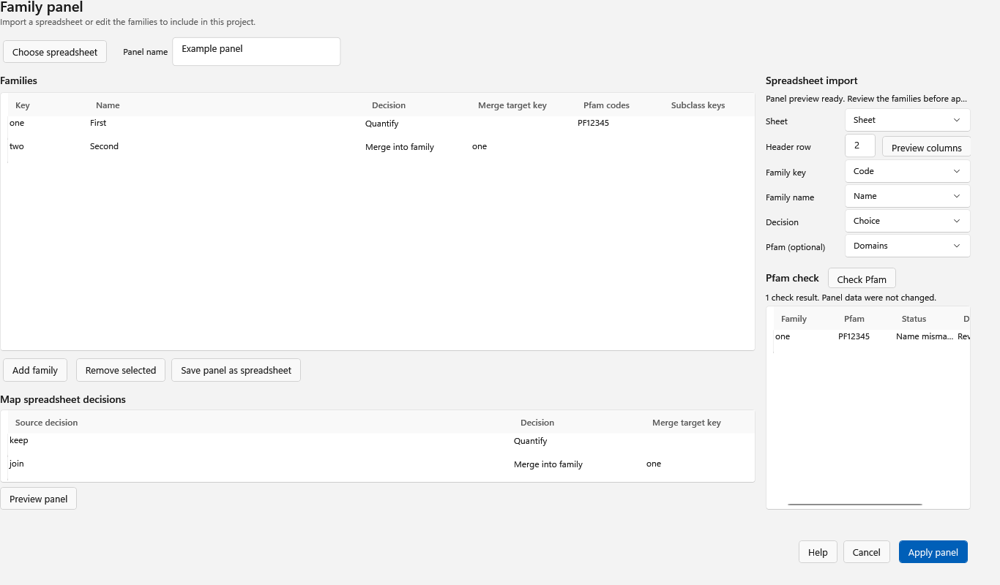

  <picture>
    <source media="(prefers-color-scheme: dark)" srcset="docs/images/familyquant-lockup-dark.png">
    
  </picture>

<h1 align="center">FamilyQuant 2.1.5</h1>

Protein-family composition from your own evidence.

FamilyQuant is a Windows desktop application for exploring protein-family composition from database identifications and de novo peptide evidence. It lets you curate families with your own panel and quantify their contributions across runs. It writes a report from the project's results, with a Word document, a workbook and an interactive page.

[Download FamilyQuant 2.1.5](https://github.com/pcarvalho75/FamilyQuant2-releases/releases/latest) · [Step-by-step guide](#step-by-step) · [Troubleshooting](#troubleshooting)

## What's new in 2.1.5

The Families screen's **Grouping** panel now numbers the steps: **Fetch evidence**, **Group by evidence**, **Fetch family world** and **Compute full XIC**. It highlights the next step and shows each step's status. **Group by evidence** offers to download evidence first when the project has none, **Review grouping** explains why a scope cannot be suggested, and the **Read grouping task** screen counts the taxa it asks UniProt about.

Earlier, **2.1.4** added database entries to the family dot plot's X, Y and Size choices. When the required measures are available, it opens with database entries against mean ion current share. To see this in an existing project, use **File > Export report** to create a fresh HTML report. No Compute is needed, and existing calculated numbers do not change.

Earlier, **2.1.3** introduced the per-user Setup.exe installer, which adds a Start menu shortcut and an uninstall entry. FamilyQuant checks for updates at start-up and offers **Install update** in a banner when a new version is available; **Help > Install update** provides the same action. To turn the start-up check off, clear **Help > Check for updates at startup**. The ZIP remains available.

Earlier highlights include the **2.1.2 interactive HTML report**, which accompanies the Word report and workbook and includes a configurable family dot plot with linked selection and details on demand. Other 2.1.x improvements include:

- **Faster Compute:** a faster search engine reduces work on the same inputs; the time depends on the project and computer.
- **Panel-family totals:** when your panel combines families, the headline presents their combined panel-family total while the supplement retains the original detail.
- **Score tier, on by default:** a de novo peptide is credited only to the proteins tied at its best score; an identified peptide is credited to the proteins that contain it. Opening an existing project preserves its stored results; the rule applies when you run Compute again.
- **Clearer reports and progress:** program-written findings, saved report details, explanations for unavailable values, counted progress and reusable search results.

## Explore the report

The `report.html` opens beside the Word report and supplement workbook. It is a self-contained page: open it in a browser, explore it offline, switch between light and dark, use it on a phone, or print it.

The ring shows family composition. Select a segment or a family in **Across the runs** to inspect it; each run is a point, so variation is visible beside the mean. Short labels keep the view readable, and pop-ups show the exact values and explanations. Displayed result numbers are traced to the selected report, supplement or stored project values; the page does not rerun the analysis.

The **Compare family measures** dot plot opens with database entries on X, mean ion current share on Y, and proteins with their own peptide as Size, when all three measures are available. Database entries are the number of the database's target entries that the curation assigns to the family; decoys and contaminants are left out. A panel family counts the distinct entries assigned to its member families. You can change X, Y and Size to other measures available in your project, such as protein estimate (greedy), peptide count, run-to-run SD and CV. Each dot represents a family, and its area reflects the selected size measure. Hover over or select a dot for its values; selecting it also selects the family elsewhere in the report. The plot labels its axis scales, and hollow markers indicate unplottable or zero-size values.

A selected family's detail shows its available parts and sequence coverage. The **Credited family signal** and **Database gap** views answer different questions and retain their own labelled bases.

On a narrow screen, select an information button to open its details. The example below shows a pop-up on a phone-sized view.

All screenshots on this page use synthetic data.

## Install or update

Use 64-bit Windows 10 or 11. FamilyQuant 2 can sit beside FamilyQuant 1.5.

Install FamilyQuant 2.1.5 for your Windows user:

1. Open the [latest release](https://github.com/pcarvalho75/FamilyQuant2-releases/releases/latest), check that it is version 2.1.5, and download its `FamilyQuant2-<version>-Setup.exe` installer.
2. Run the installer. It installs for the current user without administrator privileges in `%LOCALAPPDATA%\Programs\FamilyQuant2` and creates a Start menu shortcut.
3. If Windows shows **Windows protected your PC**, choose **More info > Run anyway**. The installer is unsigned.

Uninstall it through **Apps & features**. Upgrading keeps your data.

FamilyQuant checks for a new version at each start. When an update is available, a banner offers **Install update**; you can also choose **Help > Install update**. To stop the check at start, clear **Help > Check for updates at startup**.

If you prefer the ZIP, download it from the release page, extract **the entire ZIP** into a folder where you can write files, and run `FamilyQuant2.exe` from that folder. The ZIP is self-contained and includes the .NET runtime.

## Step-by-step

### 1. Open or create families

Choose **File > Open** to open an existing FamilyQuant project (`.fqproj`) or Family Cluster File (`.fcf`). To start from a protein database instead, choose **File > New from database**, select a FASTA or target-decoy `.T-R` file, set the identity and choose **Build families**. Open the resulting `.fcf` with **File > Open**.

Use **File > Save** to keep the project, its curation and computed results together. Use **Save as** when you want a separate copy.

### 2. Import your family panel

Choose **File > Import family panel** and select your spreadsheet. Choose the sheet and header row, preview the columns, and map your family keys, names, decisions and any optional Pfam information. Map each decision to the action you intend, review the preview and choose **Apply panel**. Panel literature, notes and sources remain your supplied text; they are not measured results.

### 3. Follow the Grouping steps

Open **View > Families**. The **Grouping** panel highlights the next step and shows the status of each step. Follow its numbered order:

1. **Fetch evidence.** Download the UniProt evidence used to review the project's proteins.
2. **Group by evidence.** Review or edit the scope and choose **Update proposal**. Review ambiguous **Panel links**, confirm your choices with **Use link choices**, inspect the updated protein selections and choose **Apply grouping**. You can add a note to a link choice, and the grouping can be undone in the session. If evidence is missing, choose **Download and continue** when offered; the download finishes before the review opens. If no scope can be suggested, read the explanation and fetch evidence or enter a scope.
3. **Fetch family world.** After confirming the grouping scope, download the reviewed family references used by quantitation. If the scope is missing, follow the offer to open **Group by evidence** first.
4. **Compute full XIC.** Open Quantify, add the matching inputs and compute as described below.

The **Read grouping task** screen counts the taxa it asks UniProt about and needs an internet connection.

### 4. Add inputs and compute

Choose **Compute full XIC** in the Grouping panel, or **Analysis > Compute full XIC**. In Quantify, set **RAW folder** to the matching `.raw` acquisitions and **Identifications (.sepr2)** to the package from the same runs. **De novo folder (optional)** can contain PEAKS `*.denovoOnly.csv` or `*.denovo.csv` files and DeepNovo `*.deepnovo.csv` files; each selected source has its own score filter. **Search settings (optional)** can point to a `.params` file; if left empty, one unambiguous adjacent file may be selected automatically.

Review the available settings and choose **Compute full XIC**. Progress shows the current step and elapsed time; **Operation log** shows recorded steps and **Cancel** requests cancellation. Save the project after a successful computation.

### 5. Read the results

Choose **Analysis > Results** to explore the stored quantitation. Return to **View > Families** to inspect family assignments and the quantitation controls. Read each chart's labels and denominator: a family with **no peptide observed** in a completed study is not proof that the family is absent. Unavailable values are shown as unavailable rather than treated as zero.

### 6. Describe and export the report

Choose **File > Report details**. Enter the title, authors, description, workflow, database kind and any written interpretation you want to include. Choose **Save details**, then **File > Save** to keep the changes in the project. The program's own findings are written from stored studies; your panel text and written interpretation remain separately identified.

Choose **File > Export report** after Results are ready. Select sections and figures; each figure is listed by what it shows. Adjust **Report threshold (%)** if needed, and choose where to save the Word report.

FamilyQuant writes three files beside one another with the same base name:

- `report.docx` - the Word report.
- `report_supplement.xlsx` - detailed tables and source values.
- `report.html` - the interactive, offline report.

The chosen base name replaces `report` in all three filenames. Keep the files together so the links between them work. Save the project if you want to retain the report choices and threshold.

### 7. Explore the HTML report

Open `report.html` in a browser. Start with the composition ring and the ranked per-run view, select a family for its details, then inspect available sequence coverage, credited signal and the Database gap. Select information buttons or values for explanations and exact values. Use the theme control for light or dark, and **Print** for a print-friendly view.

### 8. Optionally draft an interpretation with AI

The program's own report narrative is generated without an AI service. If you choose an AI draft, bring your own Anthropic API key and manage it under **Help > AI assistant key...**. The key is protected for your Windows user and is not saved in the project or report. If no key is saved and `FamilyQuant AI key.txt` is beside the opened project, the first eligible attempt offers to import it; keep that file private.

Choose **File > Draft interpretation with AI...**. Review the exact project information and model shown, and confirm before sending the information to Anthropic. Review the returned
draft and its list of recognized numbers not found in the input tables; a value match does not prove the meaning is correct. Accepting adds a labelled AI draft to the written interpretation; cancel or discard leaves the project unchanged. Use **File > Save** if you want to retain an accepted draft. Testing a key sends a short request without project data and may incur usage charges.

## Troubleshooting

- **Export report is unavailable or says Results are missing.** Open a computed project and wait for its family attribution to finish. If the project has no stored Results, run **Analysis > Compute full XIC** and save it first.
- **An input cannot be found.** Check that the RAW folder exists and contains the acquisitions, and that the `.sepr2` package matches those runs. The optional de novo folder is searched recursively for the selected source types.
- **A family shows no peptide observed.** This means no peptide reached that family in the completed study; it is not evidence that the family is absent. Check the panel, assignments, input coverage and the status shown for unavailable studies.
- **A value or panel link needs explanation.** Open **Help > How to read these numbers** for the current screen, or **Help > What do I do first?** for the full workflow. Review the panel links and the audit before applying changes.
- **The AI command asks for a key or cannot connect.** Add or import your own key under **Help > AI assistant key...** and use **Test key**. Check connectivity or the account's billing and rate limits if the app reports them. The rest of FamilyQuant and the program-written report work without a key.

For help in the application, use **Help > What do I do first?** or **Help > How to read these numbers**. Release downloads and update notes are on the [releases page](https://github.com/pcarvalho75/FamilyQuant2-releases/releases/latest).
